# Diagram Alur Repository (Gambaran Umum)

> **Status: Fixed** — Gambaran alur lintas domain dari `routes/web.php`, controller/service/model utama, dan dokumen flow di `docs/flows/`. Jika rute/permission/state berubah, perbarui dokumen ini di PR yang sama.
>
> Sumber rujukan utama: `routes/web.php`, `docs/flows/*.md`, `docs/index.md`, `docs/architecture.md`, `docs/modules.md`, `docs/security.md`.

## Cara membaca

- Diagram ini adalah **gambaran lintas domain** (autentikasi → role → Pelaporan BM → Pencatatan BM → Distribusi BHP → Master/Admin). Detail per domain ada di dokumen flow masing-masing.
- Tenis/guard penting selalu dicatat di dokumen domain; bagian ini hanya ringkasan alur.
- Semua path di repo ditulis relatif (tidak ada absolute path).

## Gambaran alur (Mermaid)

```mermaid
flowchart LR
  %% =========================
  %% Entry + Auth
  %% =========================
  U["User (browser)"] --> L{"Login (Fortify, username)"}
  L -->|gagal| L
  L -->|berhasil| PWD{"Password expired / wajib ganti?"}
  PWD -->|ya| CP["GET/POST /ubah-password\nPasswordExpiredController\n(log: ganti-password)"]
  CP --> DASH
  PWD -->|tidak| DASH["Dashboard\narah ke tampilan sesuai role"]

  subgraph ROLES["Role (RBAC)"]
    SA["super_admin\n(bypass gate)"]
    AK["admin_kcd"]
    OS["operator_sekolah / bendahara_sekolah\n(sekolah_id wajib)"]
    OD["operator_divisi\n(khusus BHP)"]
  end

  DASH --> ROLES

  %% =========================
  %% Domain 1: Pelaporan BM
  %% =========================
  subgraph PBM["Pelaporan BM (/pelaporan-bm, /dashboard)"]
    direction TB
    PBM1["Acuan\n(GET/POST/DELETE /acuan)\ntenant dikunci periode\nblokir jika dipakai / terkunci"]
    PBM2["SPJ / Pilih Bulan\n(spj/pilih-bulan, spj/*)\nimport allowlist NPSN\ngate lock/kirim"]
    PBM3["Input Realisasi\n(input-realisasi/*)\nalokasi SPJ -> acuan (kodering)\nsnapshot ke pelaporan_bm_realisasi"]
    PBM4["Daftar/ekspor Realisasi\n(realisasi, realisasi/unduh)"]
    PBM5["Cetak (check + unduh)\n(cetak/*)"]
    PBM6["Rekapan lintas sekolah\n(rekapan)"]
    PBM7["Kunci & Status Kirim\nPOST kunci-laporan/toggle\nPOST kunci-laporan/status\nstatus_kirim: draft|menunggu_approval|disetujui\nstatus_kunci boolean"]

    PBM1 --> PBM3
    PBM2 --> PBM3
    PBM3 --> PBM4
    PBM3 --> PBM5
    PBM4 --> PBM6
    PBM5 --> PBM6
    PBM3 --> PBM7
    PBM7 -->|"set disetujui\n(KunciLaporanController)"| PBM8["Trigger SinkronisasiInventarisService\nsyncPeriode(sekolah,bulan,tahun)\nbest-effort; warning jika gagal / perluReview"]
  end

  OS --> PBM
  AK --> PBM
  SA --> PBM

  %% =========================
  %% Domain 2: Pencatatan BM (Inventaris)
  %% =========================
  subgraph PCB["Pencatatan BM (/pencatatan-bm)\nGate: KunciLaporan.status_kirim == 'disetujui' (bukan status_kunci)"]
    direction TB
    PCB0["GET/POST sinkronisasi\n(super_admin, sinkronisasi-inventaris-bm)\nmanual atau setelah approval PBM"]
    PCB1["Sinkron: Realisasi periode disetujui\n-> inventaris_unit (+ register seq)\nlog: inventaris_sync_log\ndilewati jika belum disetujui"]
    PCB2["Inventaris daftar/detail\nfoto, ekspor\nsemua status tampil; dashboard hitung aktif saja"]
    PCB3["Mutasi/Penempatan\n(POST mutasi/{unit})\ntulis inventaris_mutasi"]
    PCB4["Pengembalian\n(POST pengembalian/{unit})\nunit -> dikembalikan + mutasi"]
    PCB5["Dokumen: KIR, Buku Inventaris, Sensus (PDF langsung)\n+ dokumen tersimpan (BAST, fakta integritas, surat pengembalian)\n+ koreksi/batal BA\n+ label/QR (signed URL)"]

    PBM8 --> PCB0
    PCB0 --> PCB1
    PCB1 --> PCB2
    PCB2 --> PCB3
    PCB3 --> PCB2
    PCB2 --> PCB4
    PCB4 --> PCB2
    PCB2 --> PCB5
  end

  OS --> PCB
  AK --> PCB
  SA --> PCB

  %% =========================
  %% Domain 3: Distribusi BHP
  %% =========================
  subgraph BHP["Distribusi BHP (/distribusi-bhp)\nKonteks: BOS atau BOPD (prefix/middleware sumber-dana-bhp)\nTabel terpisah per dana; penyedia/divisi bersama"]
    direction TB
    BHPD["Dashboard\nagregat BOS+BOPD (scope sekolah/divisi)"]

    subgraph BHP_MASTER["Master & operasi (konteks dana)"]
      direction TB
      BHPM["Settings, Divisi, Penyedia, Barang, Kode Rekening"]
      BHPP["Penerimaan / Buku penerimaan\nSaldo awal + import\nperubahan stok fisik"]
    end

    subgraph BHP_PENG["Pengajuan (operator_divisi / kelola-pengajuan-bhp)"]
      direction TB
      BHPG1["Create/update/delete (hanya draft)\nPOST submit -> StokService::submit\nstatus: draft -> submitted (reservasi)"]
      BHPG2{"Review (review-pengajuan-bhp)\ntidak boleh self-approval"}
      BHPG3["Approve\nDokumenService::approveDanGenerate\nsubmitted -> approved\nreservasi->pemakaian + dokumen + lock sequence"]
      BHPG4["Reject\nStokService::reject\nsubmitted -> rejected (reservasi dilepas)"]
    end

    BHPD --> BHPM
    BHPD --> BHPP
    BHPD --> BHPG1
    BHPG1 --> BHPG2
    BHPG2 -->|approve| BHPG3
    BHPG2 -->|reject| BHPG4
    BHPP --> BHPG3
  end

  AK --> BHP
  SA --> BHP
  OD --> BHP
  OS -. "jika diizinkan permission/route" .-> BHP

  %% =========================
  %% Master/Admin & Auth controls
  %% =========================
  subgraph ADM["Master Data & Admin"]
    direction TB
    M1["Master sekolah/ruang/pegawai/jabatan/penugasan\nsekolah_id dari resolver; lintas tenant sering -> 404"]
    A1["Admin: Kelola User (super_admin/admin_kcd)\naturan pasangan role-sekolah; super_admin tidak dikelola"]
    A2["Admin: Kode Barang (CRUD/import)"]
    A3["Admin: Log Aktivitas (lihat-log-aktivitas)\nadmin_kcd tidak lihat aktivitas super_admin / log ter-flag"]
    AU["Auth: /ubah-password (aliran paksa ganti)"]
  end

  SA --> ADM
  AK --> ADM
  OS --> ADM
  OD --> ADM

  PBM -. "tenant: resolveSekolahId; operator tanpa sekolah_id sering 403" .-> PCB
  BHP -. "SumberDana::dengan() + existsRule untuk master per dana; prefix bos/bopd penting" .-> BHP
```

## Rujukan dokumen terkait

| Topik | Dokumen |
|---|---|
| Pelaporan BM (detail flow) | [`pelaporan-bm.md`](pelaporan-bm.md) |
| Distribusi BHP (detail flow) | [`distribusi-bhp.md`](distribusi-bhp.md) |
| Pencatatan BM (inventaris) | [`pencatatan-bm.md`](pencatatan-bm.md) |
| Master, admin, auth | [`master-admin-auth.md`](master-admin-auth.md) |
| State machine lintas domain | [`lintas-domain-state-machine.md`](lintas-domain-state-machine.md) |
| Arsitektur & routing singkat | `../architecture.md` |
| Ringkasan modul & role | `../modules.md` |
| RBAC & tenant | `../security.md` |

## Catatan singkat (jangan diabaikan)

- **Sinkronisasi inventaris** dipicu dari **status kirim `disetujui`** pada Kunci Laporan BM (bukan dari `status_kunci`), lalu service `SinkronisasiInventarisService::syncPeriode(...)` berjalan (best-effort).
- **Distribusi BHP**: selalu perhatikan konteks sumber dana (`BOS`/`BOPD`) melalui prefix URL dan helper `SumberDana`; aksi dari halaman BOPD yang salah route dapat menyasar tabel dana lain.
- **Tenant**: `sekolah_id` berasal dari resolver server; operator tanpa `sekolah_id` sering mendapat **403** di modul Pelaporan BM/Pencatatan BM sesuai controller.